<!--
  This profile is built from images in assets/ so it matches the design in assets/src/reference.png
  in both light and dark mode. To change text, edit assets/src/sections.html, then run:
    node assets/src/fetch-data.js   (refreshes the GitHub stats numbers)
    node assets/src/render.js       (re-renders every image)
-->

  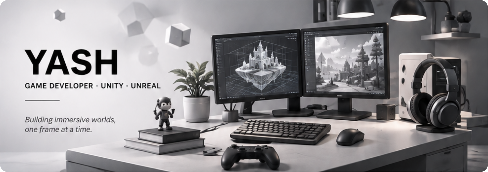

  <picture><source media="(prefers-color-scheme: dark)" srcset="assets/about-dark.png" />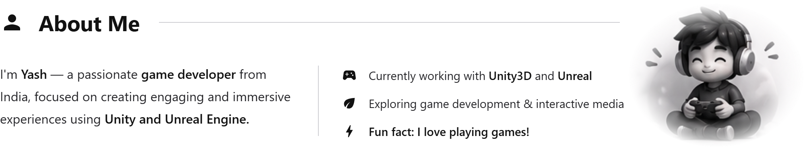</picture>

  <a href="https://ysd98.github.io/"><picture><source media="(prefers-color-scheme: dark)" srcset="assets/projects-dark.png" />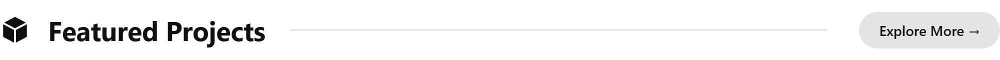</picture></a>
   
  <a href="https://ysd98.github.io/Chompu/"><picture><source media="(prefers-color-scheme: dark)" srcset="assets/project-1-dark.png" />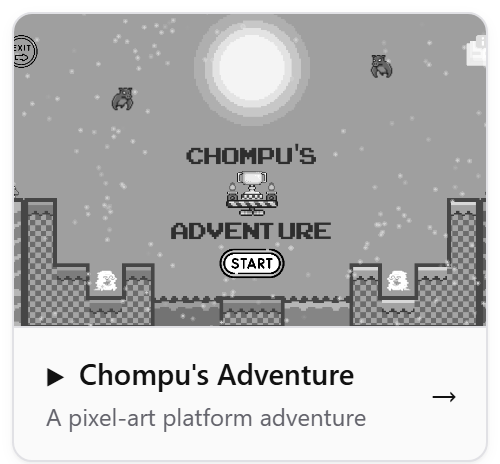</picture></a><a href="https://ysd98.github.io/Box-Shooter/"><picture><source media="(prefers-color-scheme: dark)" srcset="assets/project-2-dark.png" />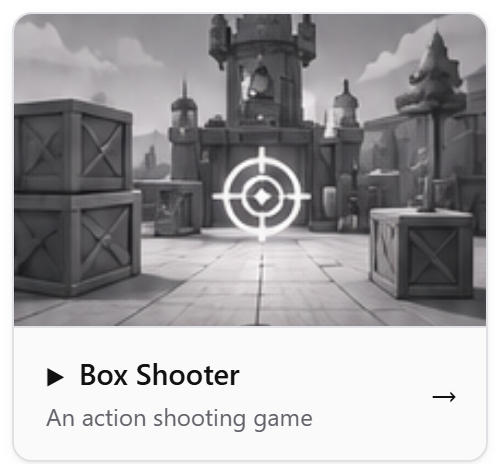</picture></a><a href="https://ysd98.github.io/Cinco_Amigos/"><picture><source media="(prefers-color-scheme: dark)" srcset="assets/project-3-dark.png" />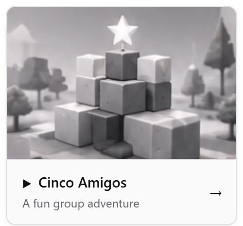</picture></a><a href="https://ysd98.github.io/College-Dept/"><picture><source media="(prefers-color-scheme: dark)" srcset="assets/project-4-dark.png" />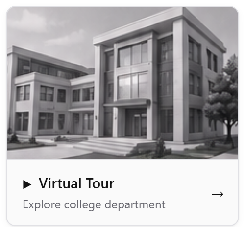</picture></a>

  <picture><source media="(prefers-color-scheme: dark)" srcset="assets/tech-dark.png" />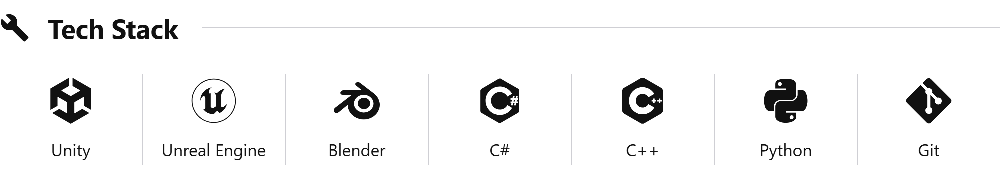</picture>

  <picture><source media="(prefers-color-scheme: dark)" srcset="assets/stats-dark.png" />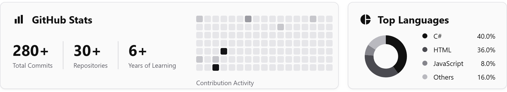</picture>

  <picture><source media="(prefers-color-scheme: dark)" srcset="assets/certs-dark.png" /></picture>
   
  <a href="https://www.credly.com/badges/a9ec2c33-1322-4033-a5b4-310b9254b528"><picture><source media="(prefers-color-scheme: dark)" srcset="assets/cert-1-dark.png" />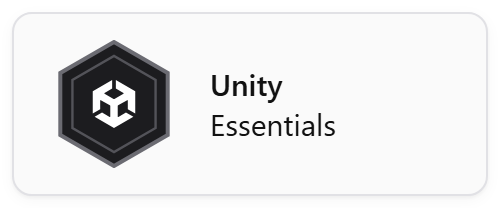</picture></a><a href="https://www.credly.com/go/zT2SOSjl"><picture><source media="(prefers-color-scheme: dark)" srcset="assets/cert-2-dark.png" />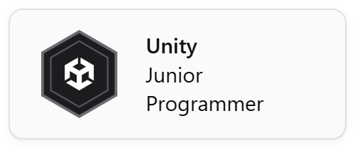</picture></a>

  <a href="https://ysd98.github.io/">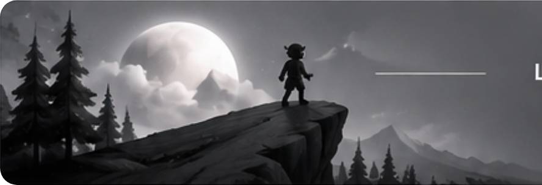</a><a href="https://linkedin.com/in/yash-dushettiwar">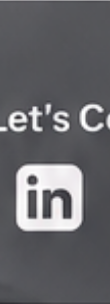</a><a href="https://instagram.com/_yd_arts_">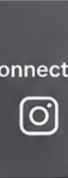</a><a href="https://ysd98.github.io/">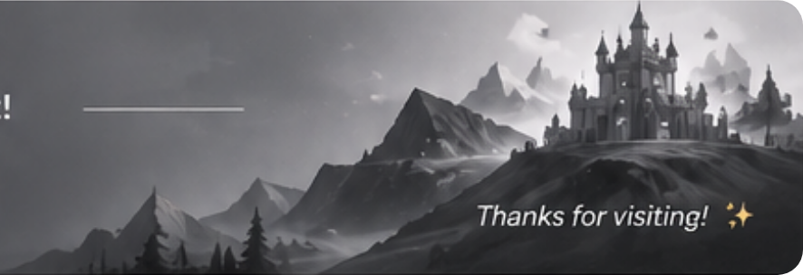</a>

